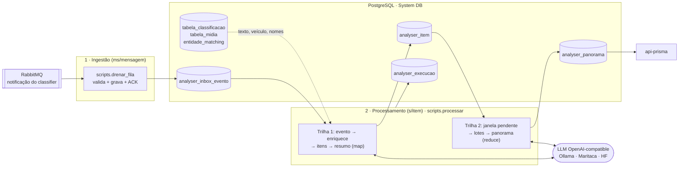

<div align="center">

# analyser-prisma

**Analisador do PRISMA**: transforma as classificações por parágrafo em **resumos por matéria** e em **panoramas mensais por ator e eixo** (negativo, neutro e positivo), gerados por LLM com rastreabilidade até a fonte.


[Organização PRISMA](https://github.com/prisma-projetos) · [Documentação técnica](docs/Prisma_Analyser_Documentacao.md)

</div>

---

## Onde este módulo fica no PRISMA

```
scrapping-prisma ──▶ classifier-prisma ──RabbitMQ──▶ [ analyser-prisma ] ──▶ System DB ──▶ api-prisma ──▶ app-prisma
                                                        ▲ você está aqui
```

O analyser recebe notícias **já classificadas** e produz o texto que o eleitor lê. Ele não reclassifica: confia no rótulo do classifier.

## Sumário

- [Ideia central](#ideia-central)
- [Arquitetura](#arquitetura)
- [Modos de execução](#modos-de-execução)
- [Como rodar](#como-rodar)
- [Configuração do modelo (LLM)](#configuração-do-modelo-llm)
- [Variáveis de ambiente](#variáveis-de-ambiente)
- [Regras invioláveis](#regras-invioláveis)
- [Testes](#testes)
- [CI/CD e deploy](#cicd-e-deploy)
- [Documentação](#documentação)
- [Repositórios do PRISMA](#repositórios-do-prisma)

## Ideia central

Duas camadas, com custos muito diferentes:

| | Resumo por item (`analyser_item`) | Panorama (`analyser_panorama`) |
|---|---|---|
| **Granularidade** | Um resumo por **matéria × ator × eixo** | Um registro por **(ator, janela, eixo, versão)** |
| **Custo** | Alto, pago **uma vez** por item | Baixo |
| **Escrita** | *Append-only*, nunca recalculado | Nova versão a cada recálculo; as anteriores são preservadas |
| **Entrada** | Trechos classificados + contexto vizinho | **Sempre** os resumos curtos, nunca o panorama anterior |

- **Janela** é o mês da **notícia** (`YYYY-MM`), e não o mês em que ela chegou.
- **Ator** pode ser político ou partido. O tratamento é idêntico e só o `tipo` muda.
- **Regra de eixo (`eixo-por-sinal-v2`)**: a matéria rende um recorte **positivo** se tem trecho positivo confiante e um **negativo** se tem trecho negativo confiante. Sem nenhum dos dois, rende um único recorte **neutro**. Uma matéria que elogia e critica gera os dois recortes, em vez de virar neutro.

## Arquitetura



**Por que ingestão e processamento são separados:** ingerir custa milissegundos e resumir custa cerca de 15 s por item. A mensagem recebe ACK assim que fica durável na inbox, e a retomada depois de uma queda é garantida pelo `status` no banco, não pela reentrega do broker.

| Tabela | Ciclo de vida |
|---|---|
| `analyser_inbox_evento` | `recebido` → `processado` \| `rejeitado` \| `erro` (deduplicada por `payload_hash`) |
| `analyser_item` | `novo` → `resumido` → `consolidado` (janela pendente = possui item `resumido`) |
| `analyser_panorama` | *Append-only* versionado. A API lê a maior `versao` |
| `analyser_execucao` | Auditoria de cada execução: `em_andamento` → `concluida` \| `falhou` |

**Resiliência:** se o provedor do LLM cair (fora do ar, timeout ou sem rede), o worker **desfaz** a unidade, espera `ESPERA_FALHA_SEGUNDOS` e tenta a mesma unidade de novo, **sem** marcá-la como erro.

### Pipeline (6 etapas)

1. **Resumo por item (map)**: gera um resumo de 2–3 frases, temas e fonte. Itens já resumidos vêm do cache.
2. **Marcação de janelas sujas**: toda janela que recebeu item novo entra na fila de recálculo.
3. **Agrupamento** pela classificação definitiva, em Python puro.
4. **Consolidação em dois níveis (reduce)**: lotes de `--lote` (padrão 100) geram parciais, e as parciais geram o panorama do eixo.
5. **Versionamento**: grava uma nova versão sem tocar nas anteriores.
6. **Verificação**: confere se todo id citado existe e se as contagens batem. Divergências viram aviso na auditoria.

## Modos de execução

| Modo | Entrypoint | Persistência | Uso |
|---|---|---|---|
| **Protótipo / demo** | `python -m analyser.cli` | JSON em `saida/` | Rodadas de exemplo, sem rede e sem chave (`ModeloFake`) |
| **Ingestão** | `python -m scripts.drenar_fila --limite N` | Postgres (`analyser_inbox_evento`) | Traz um lote limitado da fila |
| **Processamento** | `python -m scripts.processar --eventos N --consolidar-tudo` | Postgres (`analyser_item`, `analyser_panorama`) | Resume e consolida (CronJob) |
| **Consumidor contínuo** | `python -m analyser.consumidor_rabbitmq` | Inbox JSONL em `saida/` | Ingestão alternativa para uma única instância |
| **Migration** | `python -m scripts.aplicar_migration [--check-only]` | DDL `migrations/001_analyser.sql` | Job de deploy |
| **Observabilidade** | `python -m scripts.progresso [--janelas]` | Somente leitura | Mostra quanto já foi processado e quanto falta |

## Como rodar

```bash
git clone git@github.com:prisma-projetos/analyser-prisma.git
cd analyser-prisma

python -m venv .venv && source .venv/bin/activate   # Windows: .venv\Scripts\activate
pip install -r requirements.txt
```

### Demo local (sem banco, sem chave)

```bash
python -m analyser.cli --entrada dados/rodada_1.json
python -m analyser.cli --entrada dados/rodada_2.json   # demonstra cache e versionamento
```

Os dados de exemplo são **fictícios**: uma prefeita inventada de um município inventado, com 7 veículos inventados. Eles contêm casos plantados de propósito (texto equilibrado rotulado como negativo, dois atores na mesma matéria, nota protocolar e o mesmo fato em dois veículos).

### Fluxo de produção (Postgres + RabbitMQ + LLM)

```bash
cp .env.example .env    # preencha BASE_URL/MODEL/API_KEY e RABBITMQ_*; acrescente ANALYSER_DATABASE_URL

python -m scripts.aplicar_migration --schema public --check-only   # confere o schema sem alterar
python -m scripts.aplicar_migration --schema public                # aplica se o schema estiver vazio

python -m analyser.consumidor_rabbitmq --verificar-conexao         # só testa a autenticação
python -m scripts.drenar_fila --limite 200                         # 1. ingestão
python -m scripts.processar --eventos 50 --consolidar-tudo         # 2. resumo + consolidação
python -m scripts.progresso                                        # acompanhamento
```

> Mensagem drenada **sai da fila**. Ela fica durável em `analyser_inbox_evento`, mas não volta ao RabbitMQ.
>
> O executor de migration aplica a DDL quando nenhuma tabela existe, segue em frente quando todas existem e são compatíveis, e **falha** quando o schema está parcial. Uma trava transacional impede dois Jobs de rodarem a migration ao mesmo tempo.

### Docker

```bash
docker build -f docker/Dockerfile -t prisma-analyser .

docker run --rm prisma-analyser python -m analyser.cli --entrada dados/rodada_1.json
docker run --rm --env-file .env prisma-analyser python -m scripts.drenar_fila --limite 200
docker run --rm --env-file .env prisma-analyser python -m scripts.processar --eventos 50 --consolidar-tudo
```

A imagem (`python:3.12-slim`, usuário não-root) **não fixa um comando de produção**: o entrypoint é escolhido no `docker run` ou no manifesto do Kubernetes.

### Servidor de modelo local (Ollama)

```bash
docker compose up -d                                         # CPU
docker compose -f compose.yml -f compose.gpu.yml up -d       # GPU NVIDIA
docker compose exec modelo ollama pull qwen3.5:9b            # ~5,7 GB, uma única vez
```

O `compose.yml` fixa `OLLAMA_CONTEXT_LENGTH=32768`, que **precisa** ser igual a `CONTEXTO_TOKENS`. Com o padrão de 4096, o Ollama trunca o início do prompt, que é justamente onde ficam as regras.

## Configuração do modelo (LLM)

Nenhum nome de modelo aparece no código. Qualquer API **compatível com a OpenAI** funciona, e o modelo efetivamente usado fica registrado na auditoria.

| Receita | `BASE_URL` | `MODEL` | `EXTRA_BODY` |
|---|---|---|---|
| Maritaca (padrão do `.env.example`) | `https://chat.maritaca.ai/api` | `sabiazinho-4` | — |
| Ollama local | `http://localhost:11434/v1` | `qwen3.5:9b` | `{"reasoning_effort": "none"}` |
| Hugging Face router | `https://router.huggingface.co/v1` | `Qwen/Qwen3.5-9B` | `{"chat_template_kwargs": {"enable_thinking": false}}` |

> Modelos com *raciocínio* (como o Qwen3.5) precisam dele **desligado**. Com raciocínio ligado e `temperature=0`, 2 de 3 execuções devolveram resposta vazia, o que quebra o determinismo. Os detalhes medidos estão comentados em [`.env.example`](.env.example).

## Variáveis de ambiente

| Variável | Padrão | Descrição |
|---|---|---|
| `ANALYSER_DATABASE_URL` | — | Conexão PostgreSQL (System DB) |
| `BASE_URL` / `MODEL` / `API_KEY` | — | Provedor do LLM |
| `EXTRA_BODY` / `EXTRA_BODY_POR_TAREFA` | vazio | JSON repassado ao corpo da requisição (geral / por tarefa) |
| `TIMEOUT_SEGUNDOS` | `300` | Timeout **por chamada HTTP**. Em CPU, use cerca de `5400` |
| `CONTEXTO_TOKENS` | `32768` | Dimensiona o lote. Deve ser igual ao contexto do servidor |
| `SAIDA_ESTRUTURADA` | `1` | Envia o JSON Schema do Pydantic em `response_format` |
| `ESPERA_FALHA_SEGUNDOS` | `3600` | Pausa antes de tentar de novo quando o provedor cai. Deve ser menor que o `activeDeadlineSeconds` do Job |
| `RABBITMQ_HOST` / `PORT` / `VHOST` / `USE_TLS` / `HEARTBEAT` / `PREFETCH` | — | Conexão com o broker |
| `RABBITMQ_NOTIFIER_*` | — | Credenciais, exchange, fila e routing key da notificação do classifier |
| `RABBITMQ_DECLARE_TOPOLOGY` | `false` | **Sempre `false` em produção**: a topologia é da infra |

## Regras invioláveis

1. **O rótulo nunca entra no prompt do resumo (map)**, só no da consolidação (`ROTULO_NO_PROMPT = {"map": False, "reduce": True}`). O resumo é imparcial.
2. **A classificação é imutável.** O mesmo `item_id` com rótulo diferente faz a rodada inteira ser rejeitada.
3. **Resumos são *append-only*.** Não existe `atualizar_resumo` nem `apagar_resumo`.
4. **O panorama nunca é insumo de si mesmo.**
5. **Grounding estrito**: os prompts proíbem conhecimento externo sobre o ator.
6. **Rastreabilidade**: toda afirmação referencia os ids que a sustentam (`temas[].fontes`, `fontes`).
7. **A polaridade é da cobertura, não do ator.** O texto descreve o que as matérias registram.
8. **Saída estruturada obrigatória** (Pydantic), com uma tentativa de reparo antes de registrar o erro.
9. **`temperature = 0`.**

Prompts em `prompts/`: `resumo_item.txt`, `consolidacao_lote.txt` e `consolidacao_final.txt` (uma base única), mais um fragmento por eixo em `prompts/formatos/{negativo,neutro,positivo}.txt`. Cada eixo gera **um parágrafo de 3 a 6 frases**, sem ids na prosa.

<details>
<summary><b>Decisões registradas (e o que cada uma custou)</b></summary>

| Data | Decisão | Trade-off |
|---|---|---|
| 18/08/2026 | O rótulo entra no prompt do reduce | A coerência entre texto e rótulo deixa de ser evidência independente. Mitigação: o reduce não recebe instrução de tom, e um teste cobra isso |
| 19/08/2026 | Sem verificação do classificador | O custo por notícia cai pela metade, e o analyser passa a confiar no rótulo recebido |
| 31/08/2026 | As contagens são derivadas (`len(set(fontes))`), não perguntadas ao modelo | Perde-se um sinal de degradação do modelo, e ganha-se uma ordenação de temas correta |
| 31/08/2026 | A classificação é definitiva (`rotulos.json` foi removido) | Não é mais possível corrigir um rótulo dentro do analyser |
| 01/09/2026 | Um fragmento de formato por eixo (parágrafo consolidado) | A simetria por arquivo único dá lugar a três arquivos, de forma intencional |
| 03/09/2026 | `eixo-por-sinal-v2` no lugar da maioria simples | Na regra antiga, abstenções do léxico (`score=0`) viravam neutro e apagavam elogios e críticas |

Detalhes em [`docs/Prisma_Analyser_Documentacao.md`](docs/Prisma_Analyser_Documentacao.md).

</details>

## Testes

```bash
python -m pytest
```

| Arquivo | O que garante |
|---|---|
| `test_vazamento_rotulo.py` | O prompt do map não menciona o rótulo, e o do reduce nomeia o eixo sem instruir tom |
| `test_cache.py` | A rodada 2 só chama o modelo para itens inéditos |
| `test_classificacao_imutavel.py` | Repetição coerente usa o cache, e rótulo conflitante rejeita a rodada |
| `test_versionamento.py` | Agosto fica em v2 e julho em v1, com a v1 preservada |
| `test_schemas.py` | Saída malformada leva a um retry e depois a erro |
| `test_worker.py`, `test_retomada.py` | Trilhas do worker e retomada após falha do provedor |
| `test_armazenamento_postgres.py`, `test_aplicar_migration.py` | Persistência e migration |
| `test_rabbitmq.py`, `test_enriquecimento.py`, `test_auditoria.py`, … | Consumidor, enriquecimento e auditoria |

## CI/CD e deploy

`.gitea/workflows/ci-cd.yaml`: em push para `main`/`develop`, faz build da imagem → atualiza os manifestos → sincroniza no **ArgoCD**. Em Kubernetes, a migration roda como **Job** e a ingestão e o processamento rodam como **CronJobs**, com `activeDeadlineSeconds` maior que `ESPERA_FALHA_SEGUNDOS`.

## Documentação

| Documento | Conteúdo |
|---|---|
| [`docs/Prisma_Analyser_Documentacao.md`](docs/Prisma_Analyser_Documentacao.md) | Arquitetura, etapas e dicionário dos campos |
| [`docs/Integracao_RabbitMQ_Analyser.md`](docs/Integracao_RabbitMQ_Analyser.md) | Consumidor, ACK, reconexão e limites |
| [`docs/Contrato_Consolidacao_Final_Frontend.md`](docs/Contrato_Consolidacao_Final_Frontend.md) | Contrato do panorama consumido pelo frontend |
| [`docs/Teste_Integracao_Banco_Real_2026_09.md`](docs/Teste_Integracao_Banco_Real_2026_09.md) | Teste com dados reais (`qwen3.5:9b`) |
| [`docs/Auditoria_Integracao_Sistema_Completo.md`](docs/Auditoria_Integracao_Sistema_Completo.md) | Auditoria da integração de ponta a ponta |
| [`relatorios/demo_banco_2026_08.html`](relatorios/demo_banco_2026_08.html) | Relatório visual "Da notícia ao panorama" |

## Repositórios do PRISMA

| Repositório | Papel |
|---|---|
| [`.github`](https://github.com/prisma-projetos) | Página da organização |
| [`scrapping-prisma`](https://github.com/prisma-projetos/scrapping-prisma) | Coleta de notícias |
| [`classifier-prisma`](https://github.com/prisma-projetos/classifier-prisma) | Identificação de entidades e classificação do teor |
| **`analyser-prisma`** | Resumos e panoramas com LLM *(este)* |
| [`api-prisma`](https://github.com/prisma-projetos/api-prisma) | API REST somente leitura |
| [`app-prisma`](https://github.com/prisma-projetos/app-prisma) | Interface web |
| [`experiments-prisma`](https://github.com/prisma-projetos/experiments-prisma) | Documentação, ADRs e experimentos do artigo |
